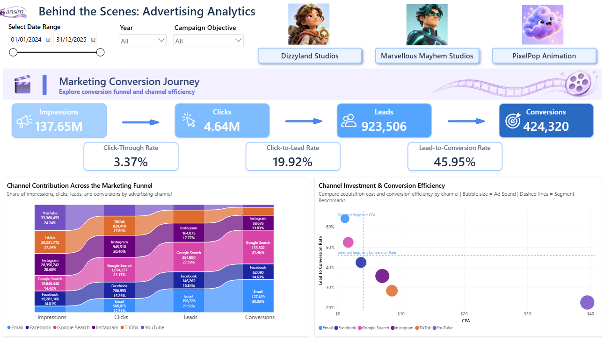
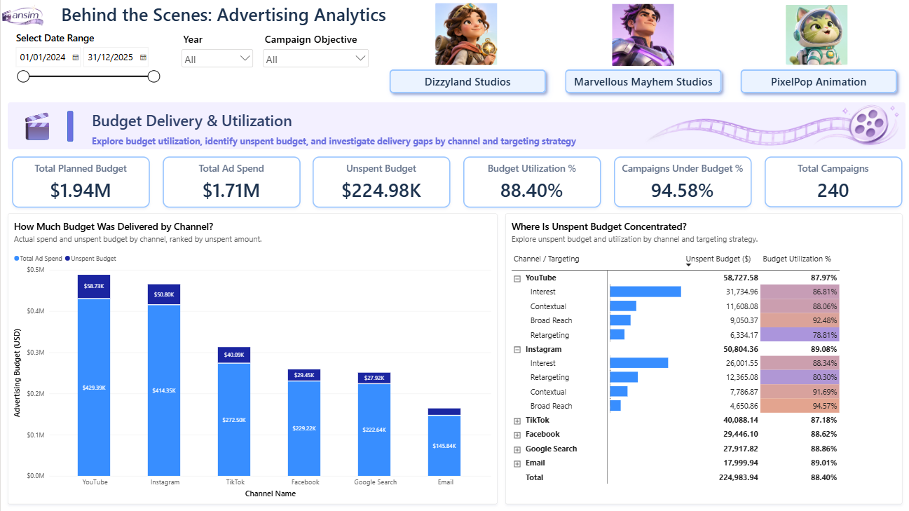
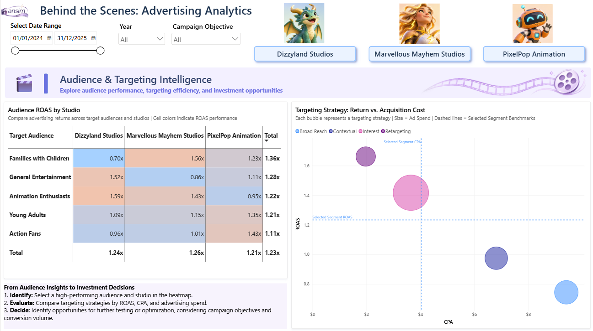
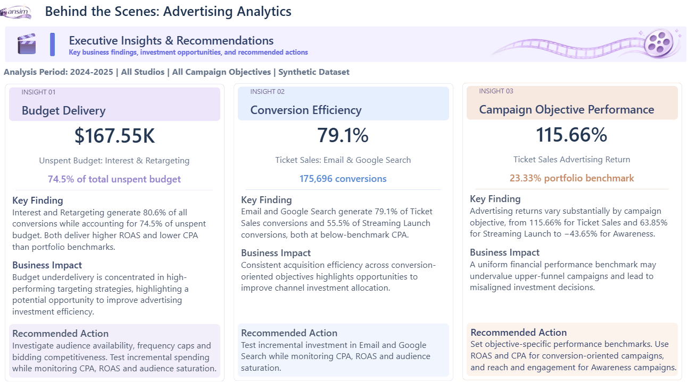
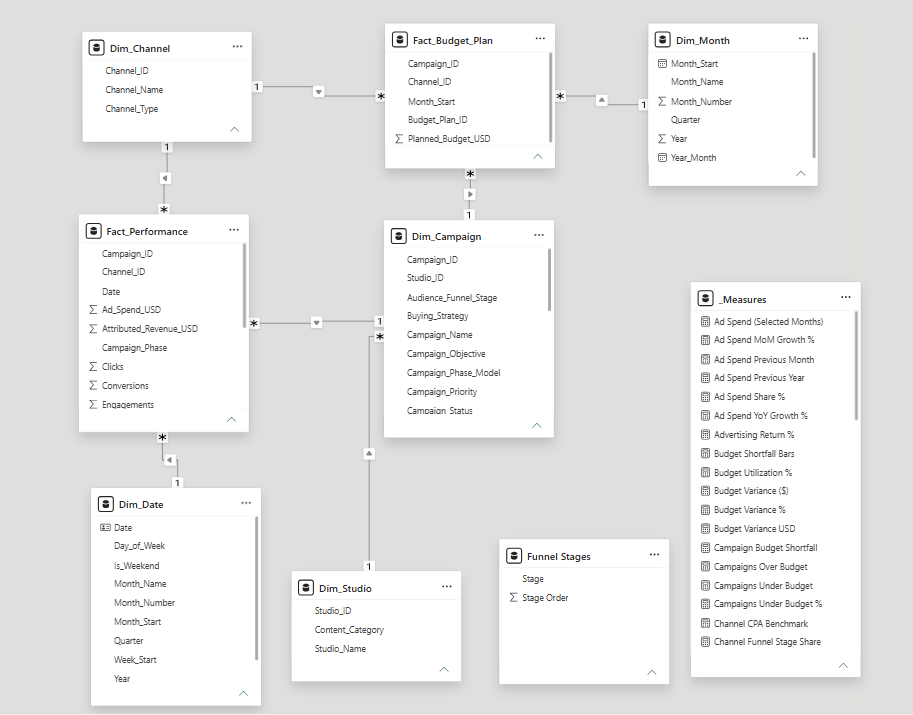

# Marketing & Advertising Analytics

### Power BI | DAX | Data Modeling | Business Intelligence

An interactive Power BI dashboard exploring marketing and advertising
performance across three fictional animation studios: Dizzyland Studios,
Marvellous Mayhem Studios, and PixelPop Animation.

The project demonstrates how advertising data can be transformed into
actionable business insights to evaluate campaign effectiveness,
analyze conversion funnels, measure advertising returns, and identify
opportunities for budget optimization.

## Project Overview

This interactive Power BI dashboard explores advertising performance across three fictional animation studios using an original synthetic dataset designed in collaboration with ChatGPT.

The project demonstrates an end-to-end business intelligence workflow, from dataset design and data modeling to KPI development, interactive visualization, and actionable business recommendations.

The analysis addresses six complementary business perspectives:

- **Executive Overview:** Advertising investment, attributed revenue, ROAS, and performance trends.
- **Conversion Journey:** Funnel performance, conversion efficiency, and channel-level acquisition costs.
- **Campaign Deep Dive:** Advertising returns and key campaign performance drivers.
- **Budget Delivery:** Planned versus actual spending, budget utilization, and investment opportunities.
- **Audience & Targeting:** Targeting effectiveness, acquisition efficiency, and budget delivery.
- **Executive Insights:** Quantified business findings, strategic implications, and actionable recommendations.

The dashboard is designed to support marketing leaders, campaign managers, and business stakeholders in evaluating advertising effectiveness and making data-informed investment decisions.

## Executive Insights & Business Recommendations

The analysis identifies three strategic opportunities to improve advertising investment efficiency, campaign performance measurement, and budget allocation.

### 1. Budget Underdelivery in High-Performing Targeting Strategies

**Key Findings**

- Interest and Retargeting account for $167.55K in unspent budget, representing 74.5% of total unspent budget.
- Together, these strategies generate 80.6% of all conversions.
- Both outperform portfolio-level ROAS and CPA benchmarks.

| Targeting Strategy | ROAS | CPA | Budget Utilization |
|---|---:|---:|---:|
| Interest | 1.42x | $3.65 | 87.36% |
| Retargeting | 1.66x | $1.97 | 82.67% |
| Overall Portfolio | 1.23x | $4.04 | 88.40% |

**Business Impact:** Budget underdelivery is concentrated in high-performing targeting strategies, highlighting a potential opportunity to improve advertising investment efficiency.

**Recommended Action:** Investigate audience availability, frequency caps, and bidding competitiveness. Test incremental spending while monitoring CPA, ROAS, and audience saturation.

### 2. Conversion Efficiency Across Advertising Channels

**Key Findings**

- Email and Google Search generate 79.1% of Ticket Sales conversions (175,696 conversions).
- These channels also generate 55.5% of Streaming Launch conversions (53,344 conversions).
- Both channels achieve below-benchmark CPA across these two campaign objectives.

| CPA | Ticket Sales | Streaming Launch |
|---|---:|---:|
| Email | $0.92 | $1.47 |
| Google Search | $1.18 | $1.94 |
| Objective Benchmark | $1.37 | $3.65 |

**Business Impact:** Consistent acquisition efficiency across conversion-oriented objectives highlights opportunities to improve channel investment allocation.

**Recommended Action:** Test incremental investment in Email and Google Search while monitoring CPA, ROAS, and audience saturation.

### 3. Objective-Specific Campaign Performance Measurement

**Key Findings**

Advertising returns vary substantially across campaign objectives:

| Campaign Objective | Advertising Return |
|---|---:|
| Ticket Sales | 115.66% |
| Streaming Launch | 63.85% |
| Consideration | 24.97% |
| Awareness | −43.65% |
| Overall Portfolio | 23.33% |

**Business Impact:** A uniform financial performance benchmark may undervalue upper-funnel campaigns and lead to misaligned investment decisions.

**Recommended Action:** Establish objective-specific performance benchmarks. Prioritize ROAS and CPA for conversion-oriented campaigns, and reach and engagement for Awareness campaigns.

*All findings are derived from the original synthetic dataset and demonstrate analytical decision-making rather than actual commercial outcomes. Recommended actions represent opportunities for further investigation and controlled testing.*

## Dataset

The project uses an original synthetic advertising dataset
designed in collaboration with ChatGPT specifically for
this portfolio project.

### Dataset Scope

| Attribute | Description |
|---|---|
| Campaigns | 240 |
| Animation Studios | 3 |
| Advertising Channels | 6 |
| Analysis Period | January 2024 – December 2025 |
| Data Granularity | Daily performance and monthly planned budgets |
| Data Source | Original synthetic dataset |

### Dataset Design

The dataset incorporates business-driven relationships between:

- Campaign objectives and advertising channels
- Targeting strategies and conversion performance
- Creative categories and advertising placements
- Advertising investment and attributed revenue
- Planned budgets and actual advertising expenditure

These relationships support meaningful analytical scenarios
rather than purely random performance distributions.

All studios, characters, campaigns, and performance results
are fictional. No proprietary or confidential business data
was used.

### Synthetic Data Generation

The original synthetic dataset was developed using Python,
Pandas, and NumPy in collaboration with ChatGPT.

The dataset was refined through multiple iterations to
establish meaningful business relationships, realistic
performance distributions, and budget delivery scenarios.

The development process incorporated:

- Scenario-based budget utilization modeling.
- Business-driven performance assumptions.
- Controlled randomization using fixed seeds.
- Monthly-to-daily advertising spend allocation.
- Financial reconciliation with cent-level precision.
- Logical constraints across conversion funnel metrics.
- Automated data quality and referential integrity checks.
- Budget reconciliation and validation reporting.

All modeling assumptions are illustrative rather than
empirically calibrated industry benchmarks.

The final synthetic dataset is embedded within the Power BI
file. Source CSV files and data generation scripts are not
included in the repository.

## Dashboard Preview

### 1. Introduction
Project background, analytical scope, and original synthetic dataset.


### 2. Executive Overview
Portfolio-level KPIs, advertising investment, attributed revenue, ROAS, and performance trends across studios.


### 3. Conversion Journey
Conversion funnel analysis, channel-level acquisition costs, and conversion efficiency across campaign objectives.



### 4. Campaign Deep Dive
Campaign-level advertising returns, performance drivers, and interactive decomposition analysis.


### 5. Budget Delivery
Planned versus actual advertising spend, budget utilization, campaign-level budget variance, and unspent budget analysis.



### 6. Audience & Targeting
Targeting strategy effectiveness, channel performance, acquisition efficiency, and investment opportunities.



### 7. Executive Insights
Three quantified business findings, their strategic implications, and actionable recommendations.



## Key Performance Indicators (KPIs)

The dashboard incorporates a comprehensive KPI framework covering five areas of advertising performance.

| KPI Category | Metrics |
|---|---|
| Financial Performance | Total Ad Spend, Attributed Revenue, ROAS, Advertising Return % |
| Audience Engagement | Impressions, Clicks, Click-Through Rate (CTR), Cost per Mille (CPM) |
| Conversion Performance | Leads, Conversions, Click-to-Lead Rate, Lead-to-Conversion Rate, Cost per Acquisition (CPA) |
| Budget Delivery | Planned Budget, Unspent Budget, Budget Utilization %, Campaigns Under Budget, Campaigns Under Budget % |
| Campaign Activity | Total Campaigns |

### Selected KPI Definitions

- **ROAS:** Attributed Revenue / Ad Spend
- **Advertising Return %:** (Attributed Revenue − Ad Spend) / Ad Spend
- **CPA:** Ad Spend / Conversions
- **CTR:** Clicks / Impressions
- **CPM:** (Ad Spend / Impressions) × 1,000
- **Budget Utilization %:** Ad Spend / Planned Budget
- **Unspent Budget:** Planned Budget − Ad Spend

Advertising Return measures revenue relative to advertising expenditure rather than overall business profitability.

Unspent Budget represents net budget variance, accounting for both underspending and overspending.

## Technical Implementation

### 1. Synthetic Dataset Design

- Designed an original synthetic advertising dataset in collaboration with ChatGPT.
- Created 240 campaigns across three fictional animation studios, six advertising channels, and two calendar years (2024–2025).
- Incorporated business-driven relationships between campaign objectives, advertising channels, targeting strategies, creative categories, and performance metrics.
- Introduced variations in campaign performance and budget utilization to support realistic analytical scenarios.

### 2. Data Preparation & Transformation

- Designed structured, analytics-ready source datasets to minimize
  downstream transformation requirements.
- Imported fact and dimension tables into Power BI using Power Query.
- Standardized column headers and assigned appropriate data types
  to identifiers, dates, and numerical performance metrics.
- Prepared separate advertising performance and budget planning
  datasets for dimensional modeling.

### 3. Data Modeling

Implemented a multi-fact dimensional data model in Power BI,
combining star and snowflake schema design principles.

| Table | Purpose |
|---|---|
| Fact_Performance | Advertising performance and outcome metrics |
| Fact_Budget_Plan | Planned advertising budgets |
| Dim_Campaign | Campaign attributes and objectives |
| Dim_Channel | Advertising channel attributes |
| Dim_Studio | Studio and content category attributes |
| Dim_Date | Daily calendar attributes |
| Dim_Month | Monthly calendar attributes for budget planning |
| Funnel Stages | Disconnected table supporting funnel visualization |
| _Measures | Centralized repository of DAX measures |

Key modeling decisions:

- Separated advertising performance and planned budget data
  into dedicated fact tables.
- Used shared campaign and channel dimensions to support
  consistent cross-fact analysis.
- Implemented separate daily and monthly time dimensions
  to accommodate different reporting granularities.
- Established one-to-many relationships with single-direction
  filtering.
- Linked studio attributes through the campaign dimension.
- Centralized DAX measures in a dedicated measures table.

#### Power BI Data Model



### 4. DAX and KPI Development

- Developed DAX measures for financial performance, conversion
  efficiency, audience engagement, and budget utilization.
- Implemented month-over-month and year-over-year performance
  comparisons.
- Developed dynamic performance benchmarks that respond to
  selected campaign segments.
- Used filter-context calculations to support campaign-level
  analysis and portfolio-level comparisons.
- Implemented virtual relationships using TREATAS to align
  daily advertising performance with monthly budget planning.

#### Advanced DAX Example: Cross-Granularity Budget Analysis

Advertising performance is recorded at daily granularity,
while planned budgets are maintained at monthly granularity.

To support consistent budget analysis without introducing
direct physical relationships between the two calendar
dimensions, DAX measures use TREATAS to propagate month-level
filters between Dim_Date and Dim_Month.

**Monthly planned budget based on daily calendar selections:**

```dax
Total Planned Budget =
CALCULATE(
    SUM(Fact_Budget_Plan[Planned_Budget_USD]),
    TREATAS(
        VALUES(Dim_Date[Month_Start]),
        Dim_Month[Month_Start]
    )
)
```

**Actual advertising spend based on monthly calendar selections:**

```dax
Ad Spend (Selected Months) =
VAR SelectedMonths =
    VALUES(Dim_Month[Month_Start])
RETURN
CALCULATE(
    [Total Ad Spend],
    TREATAS(
        SelectedMonths,
        Dim_Date[Month_Start]
    )
)
```

This approach:

- Preserves the native granularity of both fact tables.
- Supports filter propagation in either direction through
  dedicated DAX measures.
- Enables planned versus actual spending comparisons.
- Maintains a clean dimensional model without introducing
  additional physical relationships.

Budget comparisons are designed for monthly analysis.
Partial-month date selections include the full planned
budget for the corresponding months rather than prorated
daily budget amounts.

### 5. Interactive Visualization and Dashboard Design

- Designed seven dashboard pages with a consistent visual identity and analytical narrative.
- Implemented interactive slicers, cross-filtering, custom tooltips, and dynamic titles.
- Used decomposition trees to investigate campaign performance drivers.
- Developed scatter charts, heatmaps, and conversion journey visualizations to identify performance patterns and investment opportunities.
- Translated analytical findings into an executive-level summary with quantified insights and actionable recommendations.

## Business Value

The dashboard demonstrates how advertising analytics can
support strategic and operational decision-making across
marketing, campaign management, and business leadership.

Key business applications include:

- **Advertising Investment Optimization:** Identify opportunities
  to improve budget allocation across channels, campaigns,
  and targeting strategies.

- **Conversion Efficiency:** Identify channels that deliver
  stronger conversion performance at lower acquisition costs.

- **Budget Management:** Monitor budget utilization, identify
  underdelivery and overspending, and evaluate opportunities
  for incremental investment.

- **Campaign Performance Measurement:** Establish objective-specific
  KPIs and benchmarks to support more meaningful performance
  evaluations.

- **Executive Decision Support:** Translate complex analytical
  results into quantified business findings, strategic
  implications, and actionable recommendations.

The project demonstrates the complete analytical journey from
business question formulation and dataset design to technical
implementation, performance evaluation, and strategic
decision support.

## How to Explore the Dashboard

1. Download the Power BI (.pbix) file from this repository.
2. Open the file using Microsoft Power BI Desktop.
3. Navigate through the seven dashboard pages using the page tabs.
4. Use interactive slicers to explore performance across studios,
   time periods, and campaign objectives.
5. Interact with charts, decomposition trees, and tooltips to
   investigate performance drivers and investment opportunities.
6. Review the Executive Insights page for key business findings,
   strategic implications, and recommended actions.

For the best viewing experience, use Power BI Desktop in full-screen
or fit-to-page mode.

The dashboard screenshots provided in this README offer a visual
preview for users without Power BI Desktop.

## Project Information

**Project Type:** Independent Data Analytics Portfolio Project

**Tools:** Power BI, DAX

**Focus:** Marketing Analytics, Advertising Analytics,
Business Intelligence, Campaign Performance, Budget Optimization

**Portfolio:** https://ansim-lab.github.io/

---

© 2026 ansim. All rights reserved.

