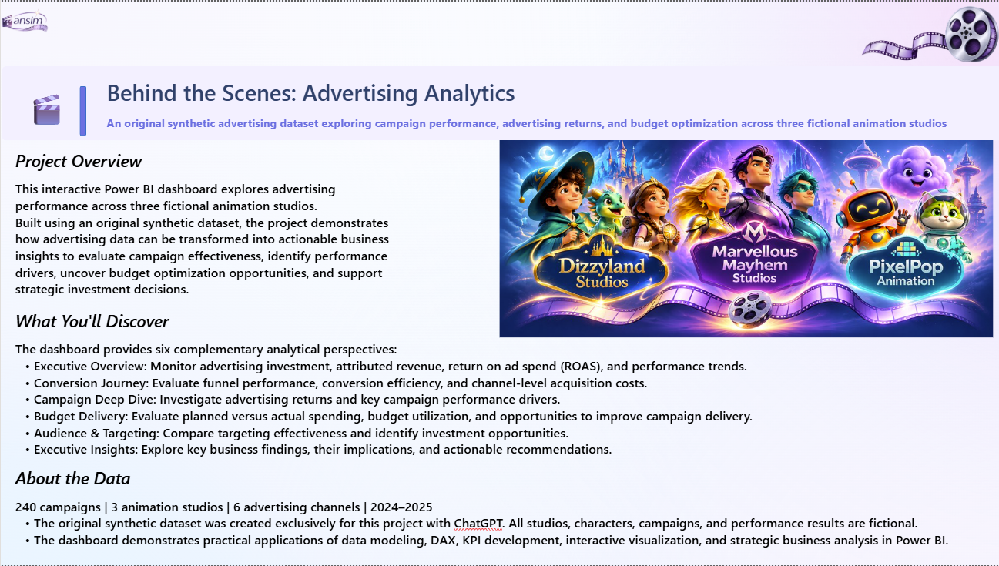
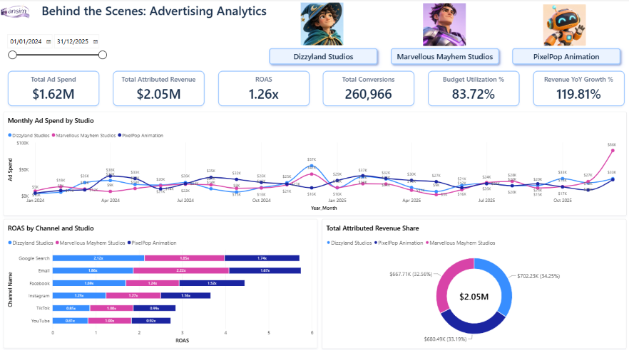
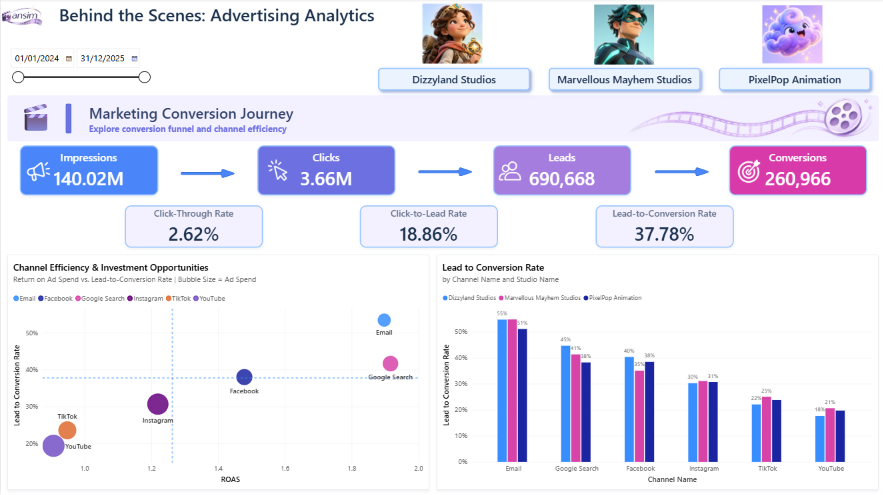
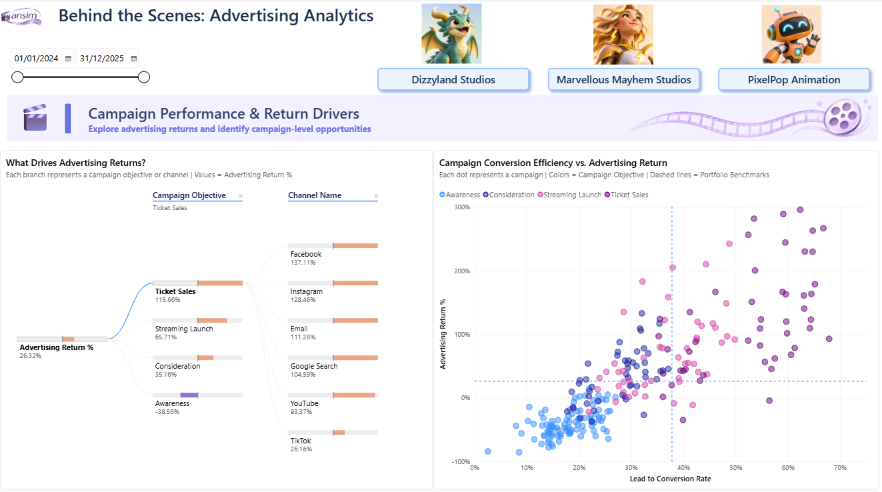
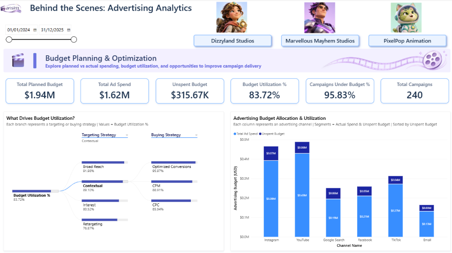

# Marketing & Advertising Analytics

### Power BI | DAX | Data Modeling | Business Intelligence

An interactive Power BI dashboard exploring marketing and advertising
performance across three fictional animation studios: Dizzyland Studios,
Marvellous Mayhem Studios, and PixelPop Animation.

The project demonstrates how advertising data can be transformed into
actionable business insights to evaluate campaign effectiveness,
analyze conversion funnels, measure advertising returns, and identify
opportunities for budget optimization.

## Project Overview

The dashboard provides four complementary analytical perspectives:

- **Executive Overview:** Monitor advertising investment, attributed
  revenue, ROAS, conversions, and performance trends.
- **Campaign Performance:** Analyze conversion funnels, engagement,
  and marketing channel efficiency.
- **Campaign Deep Dive:** Explore campaign-level returns, conversion
  efficiency, and performance drivers.
- **Budget Optimization:** Evaluate planned versus actual spending,
  budget utilization, and campaign delivery efficiency.

## Dataset

An original synthetic advertising dataset designed and developed
specifically for this portfolio project with the assistance of ChatGPT.

| Attribute | Description |
|---|---|
| Industry | Entertainment & Advertising |
| Studios | 3 fictional animation studios |
| Campaigns | 240 |
| Advertising Channels | 6 |
| Reporting Period | 2024–2025 |
| Data Type | Synthetic |

All studios, campaigns, and performance results are fictional.
The dataset was designed to support realistic marketing and
advertising analytics scenarios.

## Dashboard Preview

### 1. Introduction

Introduces the project, fictional animation studios, business
objectives, and dashboard capabilities.

### 2. Executive Overview

Provides a high-level view of advertising performance, including
spend, attributed revenue, ROAS, conversions, and revenue trends.

### 3. Campaign Performance

Explores the conversion funnel, marketing channel efficiency,
and engagement performance.

### 4. Campaign Deep Dive

Supports detailed investigation of campaign-level performance,
advertising returns, and conversion efficiency.

### 5. Budget Optimization

Analyzes planned versus actual advertising spending, budget
utilization, and opportunities to improve campaign delivery.

## Key Performance Indicators

The dashboard supports analysis of key marketing and advertising
performance metrics:

- **Advertising Spend:** Total advertising investment.
- **Attributed Revenue:** Revenue attributed to advertising campaigns.
- **ROAS:** Return on advertising spend.
- **Advertising Return %:** Advertising return relative to spend.
- **Impressions:** Total advertising impressions delivered.
- **Clicks:** Total clicks generated.
- **CTR:** Click-through rate.
- **Leads:** Total leads generated.
- **Click-to-Lead Rate:** Percentage of clicks resulting in leads.
- **Conversions:** Total completed conversion events.
- **Lead-to-Conversion Rate:** Percentage of leads resulting in conversions.
- **Budget Utilization %:** Actual spend relative to planned budget.
- **Unspent Budget:** Remaining advertising budget.
- **Campaigns Under Budget %:** Percentage of campaigns spending below budget.
- **Revenue YoY Growth %:** Year-over-year change in attributed revenue.

## Technical Implementation

**Tools & Technologies**
- Microsoft Power BI
- DAX
- Data Modeling
- Interactive Data Visualization

**Analytical Capabilities**
- KPI design and performance monitoring
- Advertising funnel analysis
- Marketing channel comparison
- Campaign-level performance analysis
- ROAS and advertising return analysis
- Budget utilization and spending efficiency
- Interactive slicers and cross-filtering
- Decomposition trees and performance exploration
- Multi-page dashboard navigation

## Business Value

The project illustrates how marketing analytics can support:

- Monitoring advertising performance against business objectives.
- Comparing campaign effectiveness across channels and studios.
- Understanding the relationship between spend, engagement,
  leads, conversions, and revenue.
- Identifying opportunities to improve advertising efficiency.
- Supporting data-driven campaign planning and budget allocation.

Because the dataset is synthetic, the results are illustrative
rather than actual commercial outcomes.

## How to Explore

1. Download the Power BI `.pbix` file from this repository.
2. Open the file in Microsoft Power BI Desktop.
3. Navigate through the five dashboard pages.
4. Use the interactive slicers and visualizations to explore results.

The screenshots above provide a preview without requiring Power BI.

## Project Information

**Project Type:** Independent Data Analytics Portfolio Project

**Tools:** Power BI, DAX

**Focus:** Marketing Analytics, Advertising Analytics,
Business Intelligence, Campaign Performance, Budget Optimization

**Portfolio:** https://ansim-lab.github.io/

---

© 2026 ansim. All rights reserved.

